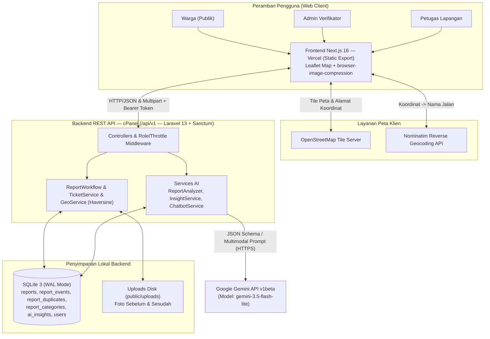
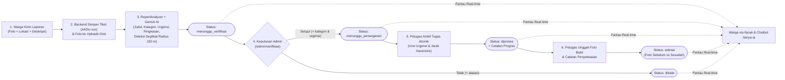

# KawalWarga — Platform Pengaduan Publik Berbasis AI

Platform pengaduan dan pemantauan masalah infrastruktur & lingkungan publik berbasis web untuk **Dinas Prasarana & Lingkungan · Kota Tangerang**, dikembangkan untuk **LOGICODIX 2026 Hackathon Competition**. KawalWarga menghubungkan **Warga**, **Admin Verifikator**, dan **Petugas Lapangan** dalam satu alur kerja transparan dengan dukungan **Google Gemini AI** (`gemini-3.5-flash-lite`) untuk triase laporan otomatis, deteksi duplikasi berbasis lokasi, ringkasan eksekutif, serta asisten chatbot 24 jam.

| Informasi Kompetisi | Keterangan |
| :--- | :--- |
| **Kompetisi** | LOGICODIX 2026 Hackathon Competition |
| **Kategori Lomba** | **Web** — Subtema 5: *Civic Tech & Community Service* |
| **Nama Aplikasi** | **KawalWarga** |
| **Live Demo (Web)** | [https://kawal-warga.vercel.app/](https://kawal-warga.vercel.app/) |
| **Hosting Produksi** | Frontend di **Vercel** (Static Export) · Backend API di **cPanel** (Laravel + SQLite) |
| **Nama Tim** | `Plantera` |
| **Anggota Tim** | 1. **Ilyasa Ramadhany Ekaputra Ismail** (Backend & AI Lead)<br>2. **Dandy Ghaisan Vidyanto** (Frontend Lead) |
| **Instansi** | Program Studi Teknik Informatika — **Universitas Pamulang** |

---

## 🎯 Masalah yang Diangkat, Solusi, & Target Pengguna

### Masalah yang Diangkat
1. **Pelaporan Lambat & Kurang Transparan**: Warga kesulitan memantau sejauh mana aduan infrastruktur/lingkungan mereka ditindaklanjuti serta jarang memperoleh bukti visual kondisi sebelum dan sesudah perbaikan.
2. **Beban Triase & Duplikasi Laporan**: Admin instansi harus menyaring aduan masuk secara manual, menentukan kategori/tingkat urgensi, dan kerap menerima laporan ganda untuk titik lokasi yang sama.
3. **Pengawasan Target Waktu (SLA) Belum Terukur**: Tanpa target waktu per tingkat urgensi, laporan berstatus darurat berisiko menumpuk atau melewati batas penanganan.

### Deskripsi Solusi
**KawalWarga** menyediakan alur pengaduan end-to-end berbasis peta interaktif dengan pendekatan **"Satu Instansi, Satu Alur Penanganan"** untuk **Dinas Prasarana & Lingkungan** yang membawahi banyak petugas lapangan:
- **Warga** dapat melapor cepat tanpa login (cukup foto terkompresi, deskripsi, dan pin lokasi peta), menyimpan salinan ID tiket & tautan pelacakan langsung ke WhatsApp via deep-link `wa.me` (*tanpa biaya gateway API eksternal*), serta memantau progres melalui `/lacak` atau asisten **Tanya AI**.
- **AI Multimodal (`gemini-3.5-flash-lite`)** menganalisis foto dan deskripsi laporan baru untuk menghasilkan judul ringkas, rekomendasi kategori, tingkat urgensi awal, serta mendeteksi kandidat laporan duplikat dalam radius **150 meter** menggunakan formula Haversine.
- **Admin Verifikator & Banyak Petugas Lapangan** bekerja pada satu sistem terukur berbasis SLA (*Darurat*: 24 jam, *Tinggi*: 3 hari, *Sedang*: 7 hari, *Rendah*: 14 hari) lengkap dengan notifikasi badge antrean verifikasi, peta sebaran, dan bukti foto penyelesaian *Sebelum vs Sesudah*.

### Target Pengguna
| Peran Pengguna | Kebutuhan Utama yang Difasilitasi |
| :--- | :--- |
| **Warga / Masyarakat Umum (Kota Tangerang)** | Mengirim aduan infrastruktur/lingkungan tanpa login, memantau progres 4 tahap, melihat foto bukti selesai, dan bertanya ke Chatbot AI 24 jam. |
| **Admin Verifikator & Pimpinan Dinas** | Memverifikasi laporan masuk dengan rekomendasi AI & peringatan duplikat, memantau peta sebaran, SLA keterlambatan, ringkasan eksekutif AI, serta mengelola kategori dan akun petugas. |
| **Petugas Lapangan** | Melihat antrean tugas siap ditangani yang terurut berdasarkan urgensi & jarak GPS terdekat, mengambil tugas secara atomik, memperbarui progres, dan mengunggah foto bukti penyelesaian. |

---

## 📸 Tangkapan Layar Alur Sistem Terpadu (End-to-End)

Dokumentasi visual alur pengaduan dan penanganan masalah infrastruktur (*Studi Kasus: Jalan Rusak*) secara lengkap dari sisi Warga, Admin Verifikator, hingga Petugas Lapangan.

### 1. Warga (Publik) — Pengajuan Laporan & Bukti Tiket
| 01. Form Buat Laporan (Desktop) | 02. Bukti Laporan Terkirim (#ADU-205) |
| :---: | :---: |
|  |  |

### 2. Admin & Pimpinan — Verifikasi AI, Monitoring, & Buku Besar
| 03. Antrean Verifikasi & Rekomendasi AI | 04. Dashboard & Peta Persebaran Pin |
| :---: | :---: |
|  |  |

| 05. Buku Besar Riwayat Seluruh Laporan (`/admin/riwayat`) |
| :---: |
|  |

### 3. Petugas Lapangan — Antrean Penanganan & Navigasi Tugas
| 06. Antrean Tugas Siap Ditangani | 07. Detail Tugas & Navigasi Sebelum Diambil |
| :---: | :---: |
|  |  |

### 4. Pelacakan Real-time & Bukti Penyelesaian Transparan
| 08. Lacak Laporan — Status Diproses Warga | 09. Form Bukti Penyelesaian Petugas |
| :---: | :---: |
|  |  |

| 10. Lacak Laporan — Selesai (Foto Sebelum vs Sesudah) |
| :---: |
|  |

### 5. Fitur Pendukung — Penolakan Terverifikasi & Tanya AI Chatbot
| 11. Lacak Laporan — Ditolak dengan Alasan | 12. Asisten Chatbot Tanya AI 24 Jam (`/tanya-ai`) |
| :---: | :---: |
|  |  |

---

## 🚀 Fitur Utama yang Diimplementasikan

- **Warga (Publik)**:
  - **Form Pelaporan Cepat Tanpa Login**: Kompresi foto otomatis di sisi klien (maks sisi `1600 px`, target `< 1.5 MB`), penentuan titik presisi peta Leaflet (pin dapat digeser & tombol *"Gunakan Lokasi Saya Saat Ini"*), pengisian alamat otomatis via reverse geocoding Nominatim OpenStreetMap, pilihan kategori dinamis, serta input nomor WhatsApp opsional.
  - **Bukti Terkirim Interaktif (`/terkirim`)**: ID tiket otomatis (`#ADU-xxx`), tombol salin tiket, dan tombol **"Simpan ke WhatsApp"** (`wa.me/?text=...`) untuk menyimpan pengingat nomor tiket & tautan pelacakan pribadi warga secara langsung (*client-side*).
  - **Pelacakan Transparan (`/lacak`)**: Mendukung 5 status (`menunggu_verifikasi`, `menunggu_penanganan`, `diproses`, `selesai`, `ditolak`) dengan stepper 4 langkah, indikator target waktu SLA, perbandingan foto **Sebelum vs Sesudah** pengerjaan, kartu kabar terbaru petugas, dan linimasa waktu lengkap.
  - **Asisten Chatbot Tanya AI (`/tanya-ai` & Widget Melayang)**: Chip pertanyaan cepat (*Cek Status Tiket*, *Lupa ID Tiket via WA*, *Cara Melapor*), pencarian tiket via ID atau nomor WhatsApp terdaftar, kartu tiket interaktif ke `/lacak`, dan penanganan rate limit ramah.
- **Admin Verifikator (`/admin`)**:
  - **Notifikasi Badge Antrean Verifikasi**: Badge jumlah laporan belum diverifikasi pada *Sidebar* dan ikon lonceng *Topbar* Admin yang selalu ter-update saat navigasi.
  - **Dashboard Monitoring Wilayah & SLA**: Kartu statistik agregat termasuk indikator laporan **Melewati Target (SLA Overdue)**, peta persebaran laporan dengan pin berwarna per status, 3 poin **Ringkasan Eksekutif AI** (dengan tombol generate ulang), serta grafik tren kategori.
  - **Antrean Verifikasi Terpadu (`/admin/verifikasi`)**: Navigator tiket, modal perbesar foto resolusi tinggi, rekomendasi AI (judul, kategori, urgensi awal, ringkasan, plus tombol analisis ulang), peringatan deteksi duplikat radius 150 m, serta kartu keputusan (*Setujui & Teruskan* atau *Tolak* dengan alasan wajib).
  - **Riwayat Seluruh Laporan (`/admin/riwayat`)**: Tabel responsif 8 baris per halaman dengan pencarian ID tiket (*debounced*), filter status, kategori, urgensi, rentang tanggal, dan pengurutan.
  - **Kelola Kategori Laporan (`/admin/kategori`)**: Tambah kategori dinamis, ubah label & deskripsi, serta aktivasi/deaktivasi kategori dengan sinkronisasi seketika ke form warga dan filter petugas.
  - **Kelola Petugas Lapangan (`/admin/petugas`)**: Tambah akun petugas baru, pantau beban tugas aktif & tuntas, serta penangguhan (*suspension*) akun dengan pencabutan token login seketika.
- **Petugas Lapangan (`/petugas`)**:
  - **Antrean Penanganan Prioritas & Jarak GPS**: Urutan otomatis berdasarkan bobot urgensi tertinggi (`Darurat` -> `Tinggi` -> `Sedang` -> `Rendah`), perhitungan jarak real-time dari GPS petugas menggunakan formula Haversine, serta filter ID tiket, kategori, dan urgensi.
  - **Detail & Pengambilan Tugas Atomik**: Rute navigasi langsung ke Google Maps, catatan verifikasi admin, target SLA penanganan, serta pengambilan laporan secara atomik untuk mencegah bentrokan antarpengambil (*concurrency-safe*).
  - **Pembaruan Progres & Penyelesaian (`/petugas/laporan?id=...`)**: Catatan progres berkala serta checklist validasi wajib (1 foto bukti hasil penanganan + catatan tindakan minimal 10 karakter) sebelum menandai tugas selesai.
  - **Tugas Saya (`/petugas/tugas-saya`) & Profil (`/petugas/profil`)**: Manajemen pekerjaan aktif/selesai, statistik kinerja petugas, dan fitur ganti kata sandi mandiri.
- **Keamanan, Target SLA, & UI Adaptif**:
  - Autentikasi Bearer Token **Laravel Sanctum** dengan *Role Guard* (`admin`, `petugas`), pencabutan sesi akun ditangguhkan (HTTP `403`), serta *Rate Limiter* (`5/menit` pengajuan laporan, `10/menit` chatbot & login).
  - Target waktu penyelesaian SLA per urgensi (**Darurat**: `24 Jam`, **Tinggi**: `3 Hari`, **Sedang**: `7 Hari`, **Rendah**: `14 Hari`) dan penanda `is_overdue`.
  - Tata letak *sticky sidebar* (`justify-between`), header mobile/desktop responsif, dan *Splash Page Loader*.

---

## 🧱 Diagram Arsitektur Sistem & Alur Data

### 1. Arsitektur Sistem


### 2. Alur Data & Siklus Hidup Laporan


---

## 🛠️ Teknologi yang Digunakan

| Lapisan | Teknologi / Layanan | Versi / Spesifikasi | Peran dalam Sistem |
| :--- | :--- | :--- | :--- |
| **Framework Frontend** | Next.js (App Router) & React | `16.4.5` / `19.3.0` | Antarmuka web *Static Export* (`output: 'export'`) di **Vercel** |
| **Bahasa & Styling** | TypeScript & Tailwind CSS | `^5` / `^4` | Type safety & utilitas tata letak responsif |
| **Ikon & Utilitas UI** | `lucide-react`, `clsx` | `^1.70.0` / `^2.1.1` | Ikon antarmuka konsisten & manajemen class CSS dinamis |
| **Peta Interaktif** | Leaflet & React-Leaflet | `^1.9.4` / `^5.0.0` | Pemilihan koordinat pin warga & peta sebaran laporan admin |
| **Kompresi Klien** | `browser-image-compression` | `^2.0.2` | Kompresi foto laporan di peramban sebelum unggah multipart |
| **Framework Backend** | PHP & Laravel Framework | `^8.3` / `^13.17` | REST API `/api/v1`, validasi request, resource JSON, & rate limiting |
| **Autentikasi API** | Laravel Sanctum | `^4.3` | Token Bearer personal dengan pembatasan peran (`admin` & `petugas`) |
| **Database** | SQLite 3 (Mode WAL) | Built-in `pdo_sqlite` | Penyimpanan relasional ringan & cepat tanpa server DBMS terpisah |
| **Kecerdasan Buatan** | Google Gemini API (`v1beta`) | `gemini-3.5-flash-lite` | Analisis laporan multimodal, deteksi duplikat, insight eksekutif, & chatbot |
| **Layanan Peta & Geo** | OpenStreetMap & Nominatim API | Public HTTPS API | Render tile peta & reverse geocoding alamat dari koordinat GPS |
| **Mode Simulasi** | Stateful In-Memory Mock | `NEXT_PUBLIC_USE_MOCK=true` | Pengujian alur frontend mandiri tanpa menyalakan backend |

---

## 🤖 Dokumentasi Penggunaan AI

KawalWarga menggunakan **Google Gemini API** (`https://generativelanguage.googleapis.com/v1beta/models/{model}:generateContent`) dengan model default **`gemini-3.5-flash-lite`** melalui `GeminiClient.php`.

### Bagian Produk yang Memanfaatkan AI
1. **Triase Laporan Otomatis & Deteksi Duplikasi (`ReportAnalyzer.php`)**
   - **Pemicu**: Saat warga mengirim laporan baru (`POST /api/v1/reports`) atau saat admin menekan analisis ulang (`POST /api/v1/admin/reports/{ticket_id}/reanalyze`).
   - **Cara Kerja**: Mengirim deskripsi teks, alamat, kandidat hingga 5 laporan terdekat dalam radius **150 meter** (disaring via bounding box SQL & jarak Haversine `GeoService`), serta foto warga secara multimodal (inline base64 jika ukuran `<= 4 MB`) dengan *JSON Schema* terstruktur.
   - **Keluaran**: Judul ringkas (`<= 70` karakter), rekomendasi kategori aktif, tingkat urgensi awal, ringkasan singkat (`<= 220` karakter), serta daftar ID tiket yang berpotensi duplikat.
2. **Ringkasan Eksekutif Dashboard Admin (`InsightService.php`)**
   - **Pemicu**: Halaman Dashboard Admin (`GET /api/v1/admin/dashboard/ai-insight` dan `.../regenerate`).
   - **Cara Kerja**: Mengirim data agregat jumlah laporan per status dan per kategori pada rentang tanggal terpilih untuk menghasilkan 3 poin ringkasan analitik beserta saran prioritas tindakan bagi admin/pimpinan.
3. **Chatbot Asisten Warga 24 Jam — Tanya AI (`ChatbotService.php`)**
   - **Pemicu**: Halaman `/tanya-ai` dan widget melayang (`POST /api/v1/chatbot`).
   - **Cara Kerja**: Mengekstrak ID tiket (`#ADU-xxx`) atau nomor WhatsApp (fitur *Lupa ID Tiket*) dari pesan pengguna di backend, mengambil status laporan dari SQLite, lalu menggunakan Gemini API untuk merangkai jawaban bahasa Indonesia yang ramah disertai hingga 3 kartu tiket interaktif.

### Perlindungan Privasi, Keamanan, & Ketahanan Fallback
- **Zero PII Leakage ke AI**: Nomor telepon pelapor (`reporter_phone`) **tidak pernah dikirim** ke prompt `ReportAnalyzer` maupun `ChatbotService`, dan pola nomor telepon pada riwayat percakapan otomatis disensor menjadi `[NOMOR_TELEPON_DISENSOR]` sebelum diteruskan ke Gemini.
- **Anti Prompt-Injection**: Input warga dibungkus dalam tag pemisah data (`<data_laporan>`, `<kandidat_duplikat>`) dengan instruksi sistem agar diperlakukan sebagai data non-instruksional.
- **Graceful Fallback**: Jika `GEMINI_API_KEY` belum diisi, timeout (`AI_TIMEOUT`), atau kuota API habis, pengajuan laporan dan dashboard tetap berjalan normal menggunakan fallback lokal (potongan deskripsi sebagai judul, status `ai_status = failed`, dan ringkasan agregat berbasis aturan).

### Penggunaan AI dalam Proses Pengembangan (Design & Coding Assistant)
Selain integrasi AI di dalam fitur produk, tim juga memanfaatkan perangkat AI secara transparan selama proses perancangan dan pengembangan (*Hacking Week*):
- **Perancangan PRD & Konsep UI/UX (Google Gemini)**: Menggunakan model **Google Gemini** (`Gemini 3.8 Flash`, `Gemini 4 Argon/Hydrogen`) untuk menyusun draf spesifikasi fitur (*PRD*), pemetaan alur pengguna, kontrak API, serta perumusan konsep dan *copywriting* antarmuka.
- **Visualisasi Desain UI/UX (Figma AI)**: Menggunakan **Figma AI** untuk memvisualisasikan draf konsep UI/UX menjadi tata letak antarmuka, komponen responsif, serta acuan *design tokens* sebelum diimplementasikan ke kode.
- **Penulisan & Refactoring Kode (AI Coding Assistant)**: Menggunakan model keluarga **Google Gemini** (`Gemini 3.8 Flash`, `Gemini 4 Argon/Hydrogen`) dan **Anthropic Claude** (`Sonnet` & `Opus`) untuk membantu penulisan *boilerplate* komponen Next.js, endpoint REST API Laravel, dan penyelarasan tipe data.
- **Debugging & Automasi Dokumentasi**: Memanfaatkan asisten AI yang sama untuk membantu pelacakan bug (CORS, state UI, tata letak responsif), pembuatan skrip pengambilan tangkapan layar (`docs/screenshots/`), dan perapihan `README.md`.

Seluruh keputusan desain akhir, kode, keamanan kredensial, dan pengujian fungsional tetap ditinjau, diuji, serta dipertanggungjawabkan sepenuhnya oleh anggota tim.

---

## 📁 Struktur Direktori

```text
├── frontend/                       # Proyek Next.js 16 (App Router, Static Export)
│   ├── public/
│   │   ├── .htaccess               # Konfigurasi Apache untuk static export di public_html
│   │   ├── favicon.ico             # Favicon resmi KawalWarga
│   │   ├── Logo.png                # Logo aplikasi KawalWarga
│   │   └── mock/                   # Foto contoh aset demo
│   ├── src/
│   │   ├── app/                    # Routing halaman Next.js (SSG static export)
│   │   │   ├── admin/              # Dashboard, verifikasi, riwayat, kategori, petugas
│   │   │   ├── petugas/            # Antrean, tugas-saya, laporan, profil
│   │   │   ├── lacak/              # Halaman pelacakan tiket warga
│   │   │   ├── tanya-ai/           # Halaman chatbot AI warga
│   │   │   ├── terkirim/           # Bukti laporan sukses terkirim
│   │   │   ├── masuk/              # Login terpadu admin & petugas
│   │   │   ├── layout.tsx          # Root layout, Google Font Inter, AuthProvider, Toast
│   │   │   └── page.tsx            # Beranda: Form buat laporan warga
│   │   ├── components/             # Komponen UI modular (Layout, Map, Chat, Report)
│   │   ├── lib/                    # API client, config wilayah, auth context, geo/formatters
│   │   └── mocks/                  # Mock data stateful untuk pengujian offline
│   ├── .env.example                # Contoh konfigurasi environment frontend
│   ├── next.config.ts              # Konfigurasi Next.js static export
│   └── package.json
├── backend/                        # REST API Laravel 13
│   ├── app/                        # Controllers, Models, Enums, Resources, Services AI
│   ├── config/                     # Pengaturan CORS, services Gemini, dll.
│   ├── database/seeders/           # 204 laporan demo sintetis & akun seeder
│   ├── routes/api.php              # Definisi rute API v1
│   ├── .env.example                # Contoh konfigurasi environment backend
│   └── composer.json
├── docs/                           # Aset dokumentasi & panduan dev lokal
│   ├── screenshots/                # Tangkapan layar antarmuka aplikasi (12 alur lengkap)
│   ├── Logo Kawal Warga.png        # Aset logo resmi KawalWarga
│   └── LOCAL-DEV.md                # Panduan setup dev lokal & troubleshooting
├── scripts/                        # Skrip helper dev lokal, reset demo, & cek kontrak
└── README.md                       # Dokumentasi utama monorepo
```

---

## 💻 Panduan Instalasi, Konfigurasi, & Menjalankan Aplikasi

### Prasyarat Sistem
- **PHP `8.3+`** (dengan ekstensi aktif: `pdo_sqlite`, `sqlite3`, `mbstring`, `openssl`, `fileinfo`, `curl`, `gd`)
- **Composer `2.x`**
- **Node.js `20.x LTS` / `22.x LTS`** dan **npm `10.x+`**

### Ringkasan Perintah Cepat

| Layanan | Perintah | URL |
|---|---|---|
| **Backend** | `cd backend && composer install && cp .env.example .env && php artisan key:generate && touch database/database.sqlite && php artisan migrate:fresh --seed && php artisan serve` | `http://localhost:8000` |
| **Frontend** | `cd frontend && npm install && cp .env.example .env.local && npm run dev` | `http://localhost:3000` |

> **Opsional (Jalankan Sekaligus)**: Gunakan `.\scripts\dev.ps1` (Windows PowerShell) atau `bash scripts/dev.sh` (macOS/Linux/Git Bash). Detail troubleshooting lengkap tersedia di [`docs/LOCAL-DEV.md`](docs/LOCAL-DEV.md).

### 1. Setup & Jalankan Backend (`backend/`)
```bash
cd backend
composer install
cp .env.example .env
php artisan key:generate
touch database/database.sqlite
php artisan migrate:fresh --seed
php artisan serve
```

### 2. Setup & Jalankan Frontend (`frontend/`)
```bash
cd frontend
npm install
cp .env.example .env.local
```
Pastikan isi `frontend/.env.local` untuk terhubung ke backend lokal:
```env
NEXT_PUBLIC_API_URL=http://localhost:8000/api/v1
NEXT_PUBLIC_USE_MOCK=false
```
Lalu jalankan:
```bash
npm run dev
```
Buka peramban di [http://localhost:3000](http://localhost:3000).

### 3. Konfigurasi Tambahan Fitur Tertentu
- **Fitur AI (Triase, Insight, Chatbot)**: Isi `GEMINI_API_KEY` dari Google AI Studio dan atur `GEMINI_MODEL=gemini-3.5-flash-lite` di `backend/.env`. Jika dikosongkan, sistem menggunakan fallback lokal agar alur pelaporan tetap berjalan.
- **Health Check AI**: Isi `HEALTH_KEY` di `backend/.env`, lalu kirim header `X-Health-Key: <nilai>` saat mengakses `GET /api/v1/health/ai`.
- **Mode Simulasi Offline Frontend**: Ubah `NEXT_PUBLIC_USE_MOCK=true` di `frontend/.env.local` jika ingin menguji antarmuka frontend menggunakan data mock in-memory tanpa menjalankan Laravel.
- **Izin Penyimpanan & SQLite WAL**: Pastikan folder `backend/database/`, `backend/storage/`, dan `backend/public/uploads/` memiliki izin tulis agar file gambar unggahan serta file `.sqlite-wal` / `.sqlite-shm` dapat dibuat.

### 4. Daftar Variabel Lingkungan (`.env.example`)

#### A. Backend (`backend/.env.example`)
| Variabel | Contoh Nilai Lokal | Keterangan |
|---|---|---|
| `APP_NAME` | `KawalWarga` | Nama aplikasi Laravel |
| `APP_ENV` | `local` | Environment (`local` / `production`) |
| `APP_KEY` | *(diisi `key:generate`)* | Kunci enkripsi aplikasi Laravel |
| `APP_DEBUG` | `true` | Detail error debug (`false` di production) |
| `APP_URL` | `http://localhost:8000` | Base URL backend untuk membentuk URL absolut foto |
| `APP_TIMEZONE` | `Asia/Jakarta` | Zona waktu server (`+07:00`) |
| `APP_LOCALE` / `APP_FALLBACK_LOCALE` / `APP_FAKER_LOCALE` | `id` / `id` / `id_ID` | Lokal bahasa pesan validasi & seeder |
| `DB_CONNECTION` | `sqlite` | Driver database SQLite |
| `DB_DATABASE` | *(opsional, path absolut `.sqlite`)* | Path file database (default Laravel: `database/database.sqlite`) |
| `FRONTEND_URL` | `http://localhost:3000` | Origin frontend yang diizinkan CORS (tanpa `/` di akhir) |
| `GEMINI_API_KEY` | *(API Key Google AI Studio)* | Kunci autentikasi Google Gemini API |
| `GEMINI_MODEL` | `gemini-3.5-flash-lite` | ID model Gemini yang dipakai backend |
| `AI_TIMEOUT` | `12` | Timeout panggilan HTTP ke Gemini (detik) |
| `GEMINI_DEBUG` | `false` | `true` untuk menampilkan detail error Gemini di chatbot lokal |
| `HEALTH_KEY` | *(kunci rahasia opsional)* | Kunci pelindung endpoint `GET /api/v1/health/ai` |
| `SANCTUM_TOKEN_EXPIRATION` | `720` | Masa aktif token login Sanctum dalam menit (12 jam) |
| `DEMO_ADMIN_PASSWORD` / `DEMO_OFFICER_PASSWORD` | `password123` | Kata sandi opsional untuk akun seeder |

#### B. Frontend (`frontend/.env.example`)
| Variabel | Contoh Nilai Lokal | Keterangan |
|---|---|---|
| `NEXT_PUBLIC_API_URL` | `http://localhost:8000/api/v1` | Base URL REST API backend (tanpa `/` di akhir) |
| `NEXT_PUBLIC_USE_MOCK` | `false` | `false` untuk API nyata; `true` untuk mode mock offline |

---

## 🔑 Akun Demonstrasi & Tiket Pengujian

### Akun Petugas & Admin (Seeder)
| Peran | Email | Kata Sandi | Halaman Masuk |
|---|---|---|---|
| **Admin Verifikator** (`Nadia Putri`) | `admin@kawalwarga.test` | `password123` | `/masuk/` |
| **Petugas Lapangan** (`Budi Santoso`) | `budi@kawalwarga.test` | `password123` | `/masuk/` |

### Tiket Sampel untuk Pengujian Pelacakan & Chatbot
| ID Tiket | Status | Kategori | Catatan Pengujian |
|---|---|---|---|
| `#ADU-204` | `menunggu_verifikasi` | Jalan Rusak | Menunggu verifikasi admin; terdeteksi mirip `#ADU-198` |
| `#ADU-198` | `menunggu_penanganan` | Jalan Rusak | Disetujui admin, prioritas Darurat, siap diambil petugas |
| `#ADU-192` | `menunggu_penanganan` | Sampah | Sampah menutup jalan di Jl. Anggrek No. 6 |
| `#ADU-200` | `diproses` | Jalan Rusak | Sedang ditangani oleh Budi Santoso (memiliki catatan kabar petugas) |
| `#ADU-176` | `selesai` | Jalan Rusak | Selesai; menampilkan foto Sebelum & Sesudah pengerjaan |
| `#ADU-183` | `ditolak` | Sampah | Ditolak admin; menampilkan alasan penolakan resmi |
| **Lupa ID** | *Pencarian Nomor* | — | Masukkan nomor WA `081299990198` di Chatbot AI |

---

## ✅ Checklist Uji Akhir Sistem (End-to-End Verification)

### 1. Alur Warga (Kirim Laporan -> Lacak Progres)
- [x] Buka halaman beranda (`/`), isi deskripsi minimal 20 karakter, unggah 1 foto bukti (terkompresi otomatis `< 1.5 MB`), pilih titik lokasi di peta Leaflet, dan kirim laporan.
- [x] Uji halaman `/terkirim?id=ADU-xxx`: tombol *"Salin ID Tiket"* dan tautan *"Simpan ke WhatsApp"*.
- [x] Buka `/lacak?id=ADU-xxx` untuk memverifikasi status *"Menunggu Verifikasi"*, stepper 4 langkah, dan foto warga.

### 2. Alur Admin (Verifikasi Laporan -> Dashboard & SLA)
- [x] Masuk di `/masuk` sebagai `admin@kawalwarga.test` / `password123`.
- [x] Periksa badge notifikasi jumlah laporan belum diverifikasi pada sidebar & ikon lonceng topbar.
- [x] Buka `/admin/verifikasi`: periksa ringkasan AI, perbesar foto warga, tinjau deteksi duplikat radius 150 m, lalu uji *"Setujui & Teruskan"* atau *"Tolak"*.
- [x] Buka `/admin`: pastikan statistik (termasuk kartu *Melewati Target* SLA), peta sebaran pin, ringkasan eksekutif AI, dan grafik tren terbarui.
- [x] Uji `/admin/riwayat`, `/admin/kategori`, dan `/admin/petugas` (termasuk fitur penangguhan akun).

### 3. Alur Petugas (Ambil Laporan -> Selesaikan -> Terlihat Warga)
- [x] Masuk di `/masuk` sebagai `budi@kawalwarga.test` / `password123`.
- [x] Pada `/petugas`, uji pengurutan prioritas & jarak GPS serta filter ID tiket, kategori, dan urgensi.
- [x] Ambil laporan secara atomik -> status berubah ke *"Diproses"* di `/petugas/tugas-saya`.
- [x] Unggah foto bukti & catatan minimal 10 karakter -> klik *"Tandai Selesai"*, lalu cek hasil komparasi foto **Sebelum** dan **Sesudah** di `/lacak?id=ADU-xxx`.
- [x] Cek halaman `/petugas/profil` dan uji ganti kata sandi mandiri.

### 4. Alur Chatbot AI (Tanya AI & Lupa Tiket)
- [x] Uji widget melayang *"Tanya AI"* dan halaman `/tanya-ai` dengan chip cepat maupun input ID `#ADU-200`.
- [x] Uji pencarian *"Lupa ID Tiket"* memakai nomor `081299990198`.
- [x] Verifikasi penanganan ramah saat batas request (`429`) tercapai.

---

## 📚 Referensi Dokumentasi (`docs/`)

- [`docs/LOCAL-DEV.md`](docs/LOCAL-DEV.md) — Panduan setup dev lokal, daftar variabel `.env`, verifikasi `curl`, dan solusi kendala umum (*troubleshooting*).

---

## 📜 Atribusi Template, Aset, Dataset, & Layanan Pihak Ketiga

1. **Framework & Library Open-Source**:
   - **Frontend**: [Next.js](https://nextjs.org/) (MIT), [React](https://react.dev/) (MIT), [Tailwind CSS](https://tailwindcss.com/) (MIT), [Lucide Icons](https://lucide.dev/) (ISC), [Leaflet](https://leafletjs.com/) (BSD-2-Clause), [React-Leaflet](https://react-leaflet.js.org/) (Hippocratic-2.1), [`browser-image-compression`](https://github.com/Donaldcwl/browser-image-compression) (MIT), [`clsx`](https://github.com/lukeed/clsx) (MIT).
   - **Backend**: [Laravel Framework](https://laravel.com/) (MIT) dan [Laravel Sanctum](https://laravel.com/docs/sanctum) (MIT).
2. **Peta, Tile, & Geocoding**:
   - Data & tile peta oleh kontributor [OpenStreetMap](https://www.openstreetmap.org/copyright) (ODbL).
   - Reverse geocoding koordinat ke nama jalan menggunakan layanan publik **Nominatim OpenStreetMap**.
3. **Layanan AI, Desain, & Tipografi**:
   - Kecerdasan buatan aplikasi menggunakan **Google Gemini API** (`gemini-3.5-flash-lite`); bantuan pengembangan & desain menggunakan **Google Gemini**, **Anthropic Claude**, dan **Figma AI**.
   - Tipografi antarmuka menggunakan font **Inter** dari [Google Fonts](https://fonts.google.com/specimen/Inter) (SIL Open Font License).
4. **Aset Visual & Dataset Demo**:
   - Logo, favicon, dan tangkapan layar aplikasi (`docs/Logo Kawal Warga.png`, `frontend/public/Logo.png`, `frontend/public/favicon.ico`, `frontend/public/mock/*`, `docs/screenshots/*`) dibuat dan disiapkan oleh tim pengembang untuk keperluan demonstrasi.
   - Seluruh **204 laporan demo** (`DemoReportSeeder.php`) dan akun seeder (`UserSeeder.php`) merupakan data sintetis (*dummy dataset*), bukan data pribadi warga sebenarnya.

---

## 👥 Tim Penyusun & Pengembang

Dikembangkan untuk **LOGICODIX 2026 Hackathon Competition** oleh mahasiswa Program Studi Teknik Informatika — **Universitas Pamulang**:

| Peran | Anggota Tim | Tautan & Portofolio |
| :--- | :--- | :--- |
| **Backend & AI Lead** | **Ilyasa Ramadhany Ekaputra Ismail** | • GitHub: [github.com/yasaramdh07](https://github.com/yasaramdh07)<br>• Portofolio: [ilyasaramadhany.my.id](https://ilyasaramadhany.my.id/) |
| **Frontend Lead** | **Dandy Ghaisan Vidyanto** | • GitHub: [github.com/SasukeWN](https://github.com/SasukeWN)<br>• Portofolio: [dandy-portofolio-blond.vercel.app](https://dandy-portofolio-blond.vercel.app/) |
