# KawalWarga — Platform Pengaduan Publik Berbasis AI

Platform pengaduan dan pemantauan masalah infrastruktur & lingkungan publik modern untuk **Dinas Prasarana & Lingkungan · Kota Harmoni**. Dibangun untuk kompetisi hackathon (deadline 15 November 2026), platform ini menghubungkan warga, admin verifikator, dan petugas lapangan dengan dukungan rekomendasi kecerdasan buatan (*AI Recommendation & Assistance*).

---

## 📸 Tangkapan Layar Antarmuka Utama

Seluruh antarmuka dirancang mengikuti sistem desain Figma (`UI.zip`) dengan dukungan penuh tampilan Desktop maupun Perangkat Bergerak (Seluler).

### 1. Warga (Publik) — Buat Laporan, Bukti Terkirim, & Pelacakan Real-time
| Buat Laporan (Desktop) | Laporan Terkirim |
| :---: | :---: |
| 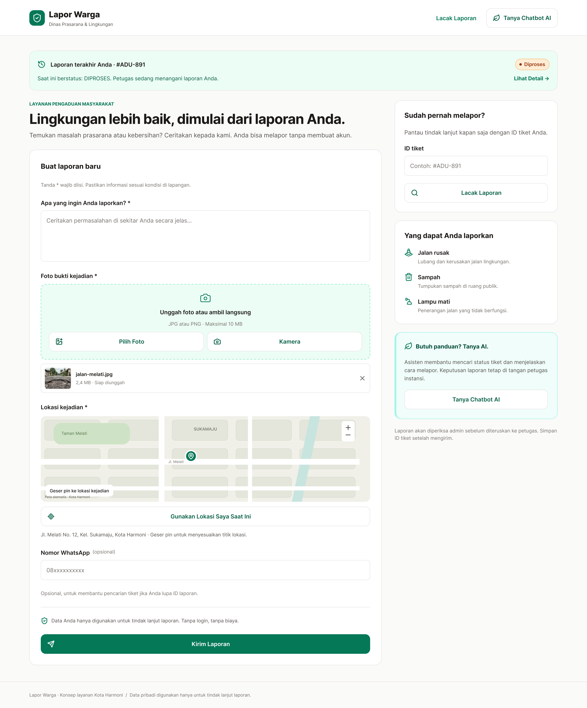 | 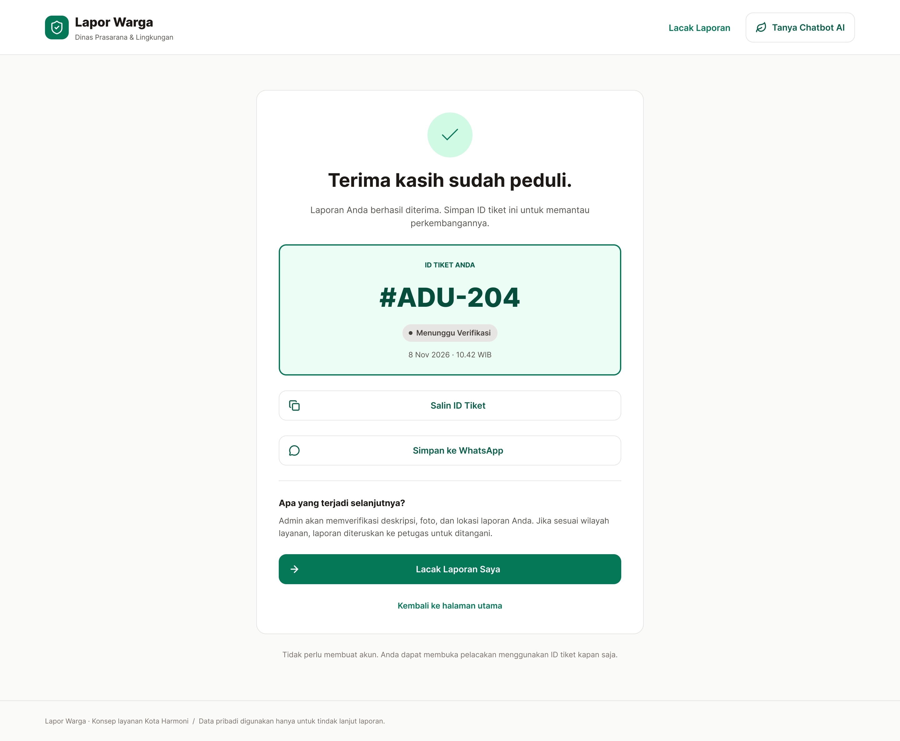 |

| Lacak Laporan — Diproses | Lacak Laporan — Selesai (Sebelum & Sesudah) |
| :---: | :---: |
| 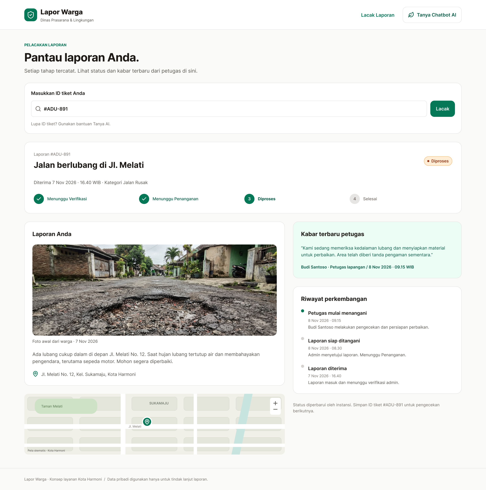 | 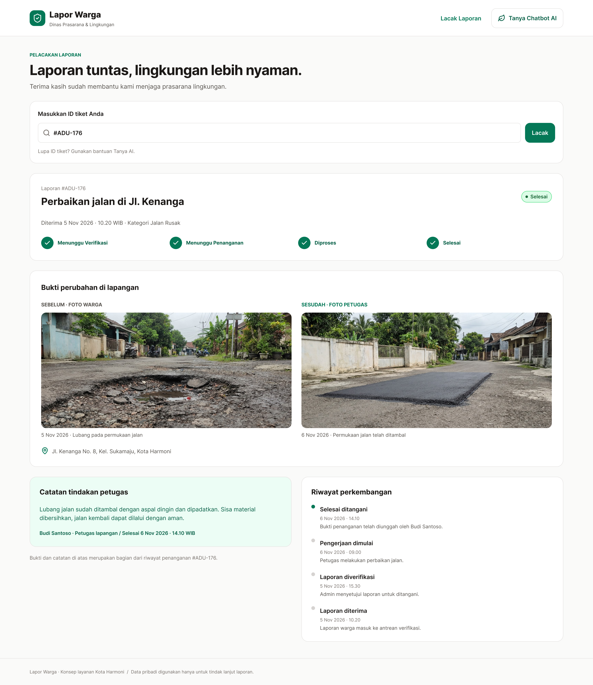 |

### 2. Warga — Asisten Chatbot AI 24 Jam & Pelacakan Ditolak
| Tanya AI Chatbot (`/tanya-ai`) & Widget | Lacak Laporan — Ditolak dengan Alasan |
| :---: | :---: |
| 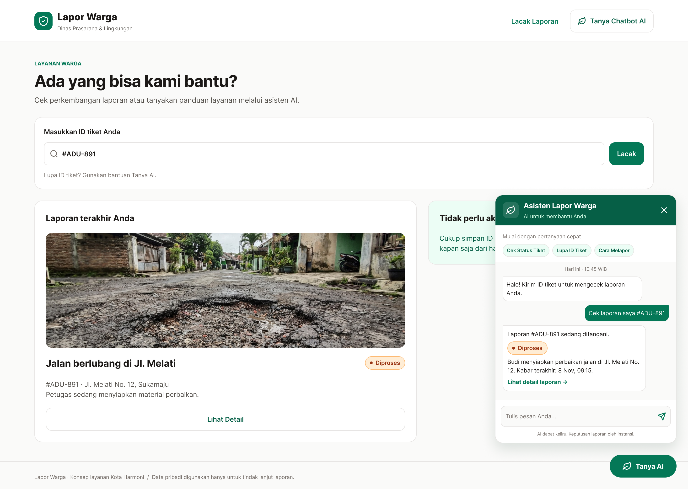 | 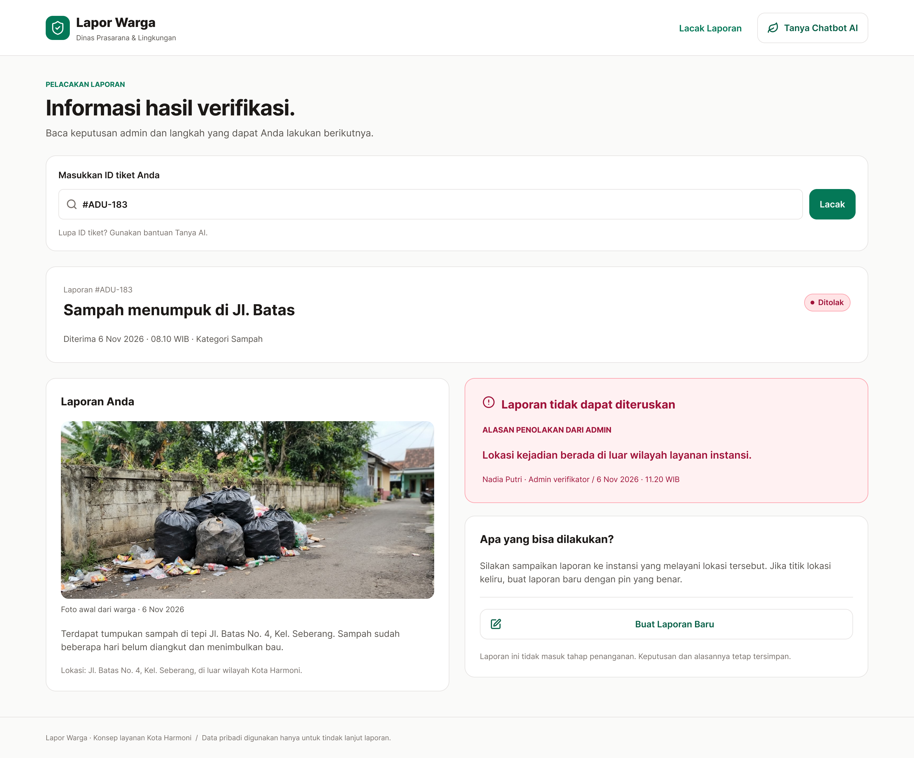 |

### 3. Admin & Pimpinan — Monitoring Wilayah, Antrean Verifikasi, & Riwayat
| Dashboard Monitoring & Peta Persebaran Pin | Antrean Verifikasi & Rekomendasi AI |
| :---: | :---: |
| 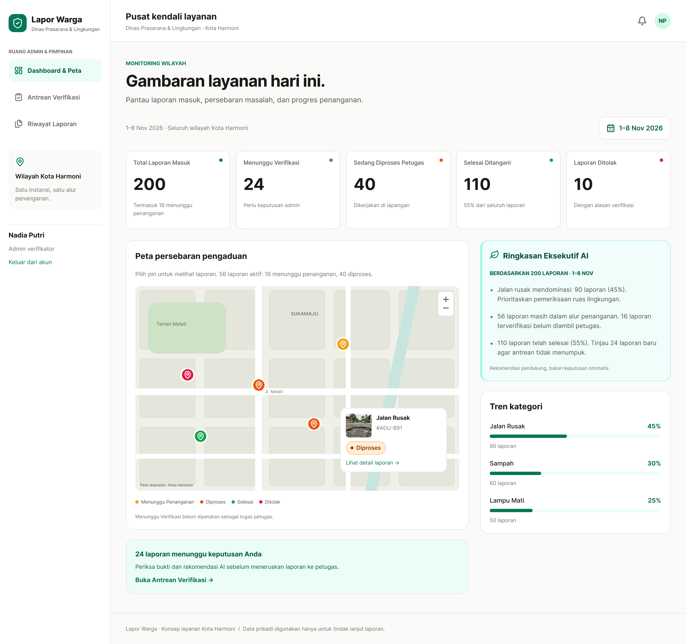 | 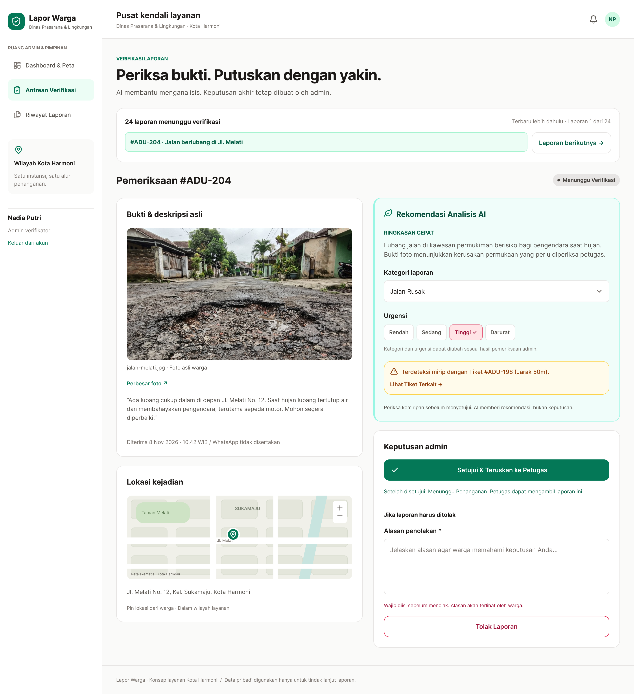 |

| Buku Besar Riwayat Seluruh Laporan (`/admin/riwayat`) |
| :---: |
| 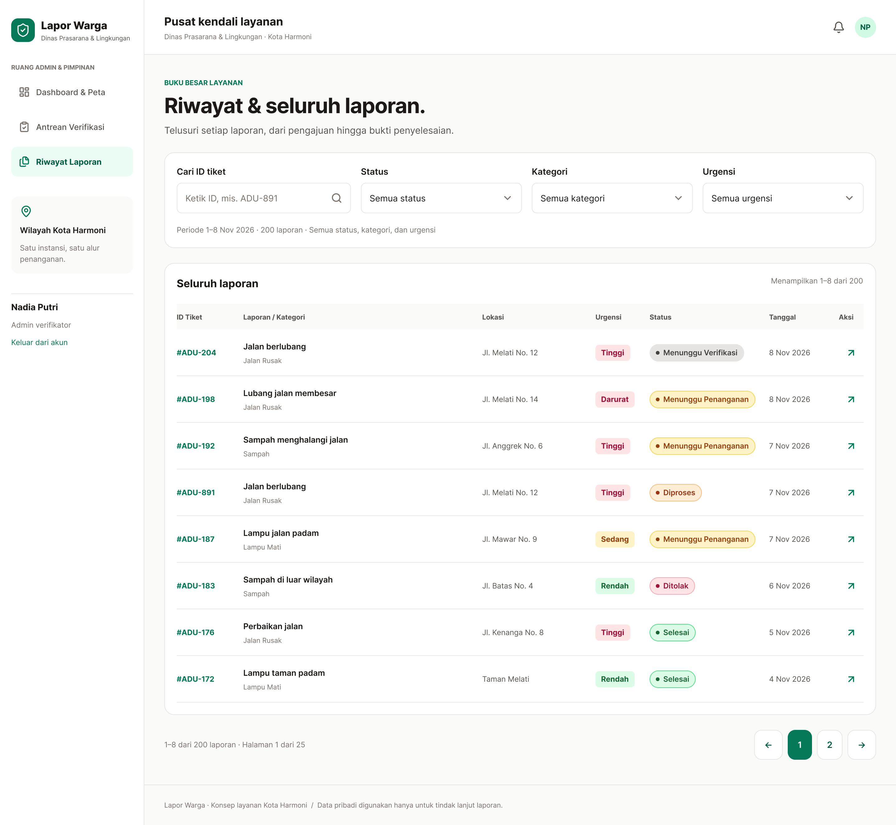 |

### 4. Petugas Lapangan — Antrean Penanganan & Penyelesaian Tugas
| Antrean Tugas Siap Ditangani (`/petugas`) | Detail Tugas & Form Penyelesaian (`/petugas/laporan`) |
| :---: | :---: |
| 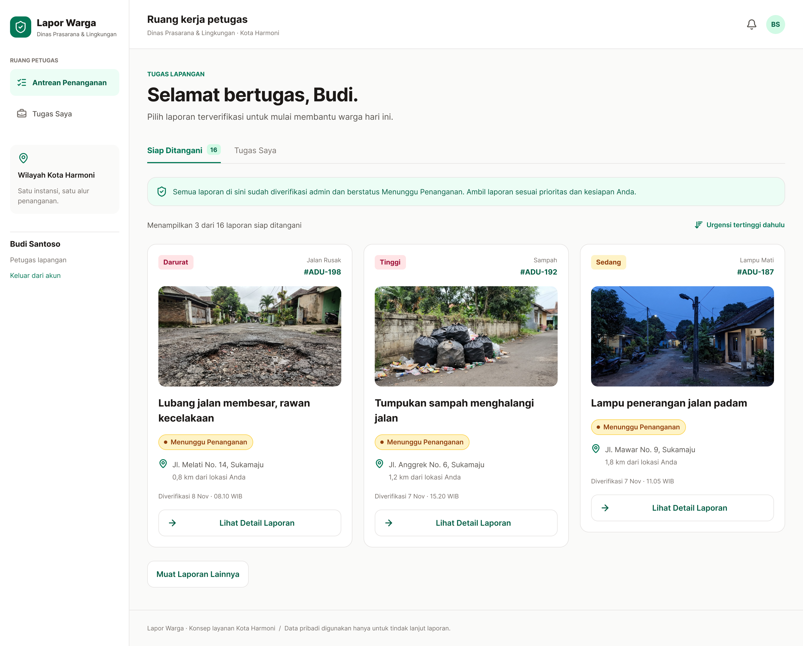 | 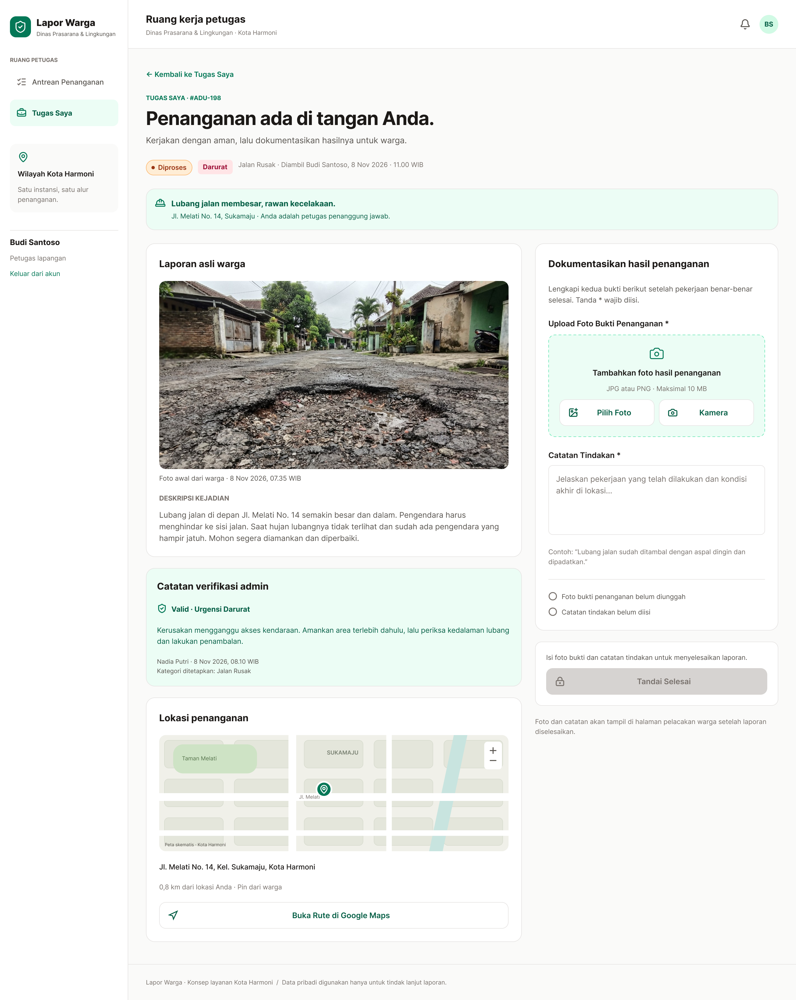 |

---

## 🚀 Fitur Unggulan

- **Warga (Publik)**:
  - Form pelaporan cepat tanpa login: kompresi foto otomatis di sisi klien (maks sisi 1600 px, target `< 1.5 MB`), penentuan titik presisi peta Leaflet (pin dapat digeser & tombol *"Gunakan Lokasi Saya Saat Ini"*), alamat otomatis via reverse geocoding, serta input nomor WhatsApp opsional.
  - Halaman bukti terkirim dengan tombol salin tiket dan integrasi tombol *"Simpan ke WhatsApp"* (`wa.me`).
  - Halaman lacak status multi-kondisi (`menunggu_verifikasi`, `menunggu_penanganan`, `diproses`, `selesai`, `ditolak`) dengan stepper 4 langkah, perbandingan foto Sebelum/Sesudah pengerjaan, kartu kabar terbaru petugas, dan riwayat linimasa waktu.
  - Asisten Chatbot AI (`/tanya-ai`) dan widget melayang 24 jam dengan chip pertanyaan cepat (*Cek Status Tiket*, *Lupa ID Tiket via WA*, *Cara Melapor*), tautan kartu tiket interaktif, dan penanganan rate limit ramah.
- **Admin Verifikator (`/admin`)**:
  - Dashboard monitoring wilayah: 5 kartu statistik agregat, peta persebaran laporan terverifikasi dengan pin berwarna per status dan popup detail, 3 poin **Ringkasan Eksekutif AI** (dengan tombol generate ulang), serta visualisasi tren kategori.
  - Antrean verifikasi terpadu (`/admin/verifikasi`): kartu navigator tiket, modal perbesar foto asli warga, rekomendasi AI (analisis ringkas, pilihan kategori & urgensi awal), deteksi duplikat laporan terdekat (jarak radius meter), serta kartu keputusan (Setujui ke Petugas atau Tolak dengan alasan wajib).
  - Riwayat seluruh laporan (`/admin/riwayat`): tabel responsif 8 baris per halaman, filter debounced pencarian ID tiket, filter status, kategori, urgensi, rentang tanggal, dan sorting.
  - **Kelola Petugas Lapangan (`/admin/petugas`)**: Penambahan akun petugas baru (email, kata sandi, nama, posisi), monitoring statistik beban kerja petugas (sedang dikerjakan & tuntas), serta fitur penangguhan (*suspension*) akun non-aktif dengan pencabutan sesi login otomatis.
  - **Kelola Kategori Laporan (`/admin/kategori`)**: Tambah kategori baru dinamis, ubah label & deskripsi, serta aktivasi/deaktivasi kategori dengan sinkronisasi seketika ke formulir warga dan filter petugas.
- **Petugas Lapangan (`/petugas`)**:
  - Antrean laporan siap ditangani berurutan berdasarkan urgensi tertinggi (Darurat -> Tinggi -> Sedang -> Rendah), indikator jarak real-time dari lokasi petugas via Geolocation + formula Haversine.
  - **Filter Antrean & Tugas**: Filter pencarian cepat berdasarkan ID Tiket (debounced), dropdown kategori dinamis, dan tingkat urgensi pada tab Siap Ditangani maupun Tugas Saya.
  - Detail laporan sebelum diambil: rute navigasi Google Maps sekali klik, catatan verifikasi admin, dan aksi ambil laporan secara atomik anti-balapan (*concurrency-safe*).
  - Form penyelesaian tugas (`/petugas/laporan?id=...`): checklist validasi interaktif 2 syarat (unggah 1 foto bukti hasil penanganan + catatan tindakan minimal 10 karakter) sebelum tombol selesai aktif.
  - Manajemen tugas tanggung jawab aktif dan riwayat pekerjaan selesai (`/petugas/tugas-saya`).
  - **Profil & Keamanan Akun (`/petugas/profil`)**: Ringkasan data diri petugas, statistik laporan ditangani, dan formulir ubah kata sandi mandiri dengan validasi kata sandi saat ini.
- **Keamanan & Kontrol Akses Terpadu**:
  - Autentikasi berbasis token Laravel Sanctum dengan perlindungan *Role Guard* terpisah (`admin` dan `petugas`).
  - Pembatasan login dan pencabutan token aktif seketika jika akun petugas ditangguhkan oleh admin (HTTP 403 Forbidden).

---

## 🛠️ Arsitektur & Teknologi

| Komponen | Teknologi | Keterangan |
|---|---|---|
| **Frontend** | Next.js 16 (App Router), TypeScript, Tailwind CSS, Lucide Icons | Diekspor sebagai **Static HTML/CSS/JS Export** (`output: 'export'`) |
| **Peta Interaktif** | Leaflet, React-Leaflet | Komponen client-only tanpa dependensi SSR |
| **Kompresi Klien** | `browser-image-compression` | Kompresi foto sebelum upload multipart |
| **Backend API** | Laravel 11 / 12, Laravel Sanctum, PHP 8.2+ | REST API berbasis Bearer Token Sanctum |
| **Database** | SQLite 3 (Mode WAL — *Write-Ahead Logging*) | Performa tinggi, tanpa konfigurasi DBMS berat |
| **Kecerdasan Buatan** | Google Gemini API (`gemini-2.5-flash`) | Analisis laporan, deteksi duplikasi, ringkasan eksekutif, dan Chatbot AI |
| **Mode Mock** | In-Memory Stateful Mock (`NEXT_PUBLIC_USE_MOCK=true`) | Simulasi alur lengkap tanpa memerlukan server backend berjalan |

---

## 📁 Struktur Direktori

```text
├── frontend/                       # Proyek Next.js (App Router, Static Export)
│   ├── public/
│   │   ├── .htaccess               # Konfigurasi Apache untuk static export di public_html
│   │   ├── favicon.ico             # Favicon instansi KawalWarga
│   │   └── mock/                   # Foto contoh aset demo
│   ├── src/
│   │   ├── app/                    # Routing halaman Next.js (SSG static export)
│   │   │   ├── admin/              # Dashboard, verifikasi, riwayat, kategori, petugas
│   │   │   ├── petugas/            # Antrean, tugas-saya, laporan, profil
│   │   │   ├── lacak/              # Halaman pelacakan tiket warga
│   │   │   ├── tanya-ai/           # Halaman chatbot AI warga
│   │   │   ├── terkirim/           # Bukti laporan sukses terkirim
│   │   │   ├── masuk/              # Login terpadu admin & petugas
│   │   │   ├── layout.tsx          # Root layout, Google Font Inter, AuthProvider, Toast
│   │   │   └── page.tsx            # Beranda: Form buat laporan warga
│   │   ├── components/             # Komponen UI modular (Design System, Map, Chat)
│   │   ├── lib/                    # API client, auth context, formatters, label enum
│   │   └── mocks/                  # Mock data stateful untuk pengujian offline
│   ├── .env.example                # Contoh konfigurasi environment frontend
│   ├── next.config.ts              # Konfigurasi Next.js static export
│   └── package.json
├── backend/                        # REST API Laravel
│   ├── app/                        # Controllers, Models, Resources, Services AI
│   ├── database/seeders/           # 204 laporan demo & akun seeder
│   ├── config/cors.php             # Pengaturan CORS origin domain frontend
│   └── routes/api.php              # Definisi rute API v1
├── docs/                           # Dokumentasi spesifikasi & kontrak API (Satu Sumber)
│   ├── design/                     # Referensi layar desain Figma
│   ├── screenshots/                # Tangkapan layar antarmuka aplikasi (11 gambar)
│   ├── API-Contract.md             # Acuan tunggal kontrak API v1.1
│   ├── Frontend-PRD.md             # Spesifikasi teknis frontend
│   ├── Backend-PRD.md              # Spesifikasi teknis backend & prompt Gemini
│   ├── Integration-PRD.md          # Spesifikasi integrasi monorepo, E2E, & deploy
│   ├── Design.md                   # Spesifikasi desain visual & token
│   ├── DEPLOY.md                   # Panduan deployment gabungan cPanel
│   └── api-smoke-test.http         # Koleksi request uji manual seluruh endpoint API
├── scripts/                        # Skrip pemeriksaan kontrak & paket build produksi
└── README.md                       # Dokumentasi utama monorepo
```

---

## 💻 Panduan Menjalankan di Komputer Lokal

| Layanan | Perintah | URL |
|---|---|---|
| **Backend** | `cd backend && composer install && cp .env.example .env && php artisan key:generate && php artisan migrate:fresh --seed && php artisan serve` | `http://localhost:8000` |
| **Frontend** | `cd frontend && npm install && npm run dev` | `http://localhost:3000` |

Konfigurasi lokal yang harus cocok:

| File | Isi |
|---|---|
| `backend/.env` | `APP_URL=http://localhost:8000`, `FRONTEND_URL=http://localhost:3000`, `DB_DATABASE` (path ke `database/database.sqlite`), `GEMINI_API_KEY`, `GEMINI_MODEL` |
| `frontend/.env.local` | `NEXT_PUBLIC_API_URL=http://localhost:8000/api/v1`, `NEXT_PUBLIC_USE_MOCK=false` |

### 1. Menjalankan Frontend

```bash
cd frontend

# Pasang dependensi
npm install

# Buat berkas environment
cp .env.example .env.local

# Jalankan server development
npm run dev
```

Buka peramban di [http://localhost:3000](http://localhost:3000).

> **Pilihan Mode API Frontend (`frontend/.env.local`)**:
> - **Mode Mock Mandiri (Offline)**: `NEXT_PUBLIC_USE_MOCK=true` (dapat langsung mencoba seluruh alur tanpa menyalakan backend).
> - **Mode API Nyata (Online)**: `NEXT_PUBLIC_USE_MOCK=false` dan `NEXT_PUBLIC_API_URL=http://localhost:8000/api/v1`.

### 2. Menjalankan Backend (Laravel)

```bash
cd backend

# Pasang dependensi PHP
composer install

# Siapkan environment dan generate APP_KEY
cp .env.example .env
php artisan key:generate

# Inisialisasi database SQLite dan isi 204 laporan demo
touch database/database.sqlite
php artisan migrate:fresh --seed

# Jalankan server API backend
php artisan serve
```

Server backend berjalan di [http://localhost:8000](http://localhost:8000).

---

## 🔑 Akun Demo & Tiket Pengujian

### Akun Petugas & Admin

| Peran | Email | Kata Sandi | Halaman Masuk |
|---|---|---|---|
| **Admin Verifikator** | `admin@kawalwarga.test` | `password123` | `/masuk/` |
| **Petugas Lapangan** | `budi@kawalwarga.test` | `password123` | `/masuk/` |

### Tiket Sampel untuk Pengujian Pelacakan & Chatbot

| ID Tiket | Status | Kategori | Catatan Pengujian |
|---|---|---|---|
| `#ADU-204` | `menunggu_verifikasi` | Jalan Rusak | Menunggu verifikasi admin; terdeteksi mirip `#ADU-198` |
| `#ADU-198` | `menunggu_penanganan` | Jalan Rusak | Disetujui admin, prioritas Darurat, siap diambil petugas |
| `#ADU-192` | `menunggu_penanganan` | Sampah | Sampah menutup jalan di Jl. Anggrek No. 6 |
| `#ADU-200` | `diproses` | Jalan Rusak | Sedang ditangani oleh Budi Santoso (memiliki catatan kabar petugas) |
| `#ADU-176` | `selesai` | Jalan Rusak | Selesai; menampilkan foto Sebelum & Sesudah pengerjaan |
| `#ADU-183` | `ditolak` | Sampah | Ditolak admin; menampilkan alasan penolakan resmi |
| **Lupa ID** | *Pencarian Nomor* | — | Masukkan nomor WA `081299990198` di Chatbot AI |

---

## 🌐 Panduan Deployment Lengkap ke cPanel

Platform KawalWarga dirancang untuk dapat di-deploy dengan mudah ke shared hosting cPanel standar:
- **Frontend**: Di-deploy sebagai static files ke root `public_html/` (atau subdomain frontend `https://DOMAINKITA.com`).
- **Backend API**: Di-deploy ke folder di luar `public_html` (misal `/home/USER/kawalwarga-api`) dengan document root subdomain mengarah ke folder `public/` (`https://api.DOMAINKITA.com`).

---

### A. Deployment Frontend ke `public_html`

#### Langkah 1: Build Production Static Export
Pastikan variabel environment diarahkan ke backend produksi:
Di `frontend/.env.local` atau `frontend/.env.production`:
```env
NEXT_PUBLIC_API_URL=https://api.DOMAINKITA.com/api/v1
NEXT_PUBLIC_USE_MOCK=false
```

Jalankan perintah build:
```bash
cd frontend
npm run build
```
Seluruh file statis siap saji otomatis terbentuk di direktori `frontend/out/`.

#### Langkah 2: Kompresi Berkas `out/`
Kompresi seluruh isi folder `frontend/out/` menjadi berkas ZIP (misal: `kawalwarga-frontend.zip`).
> **Penting**: Pastikan file `.htaccess` di dalam folder `frontend/out/` ikut terkompresi.

#### Langkah 3: Unggah & Ekstrak via cPanel File Manager
1. Masuk ke cPanel hosting Anda, buka menu **File Manager**.
2. Masuk ke direktori `public_html/` (atau document root domain utama).
3. Klik tombol **Upload** dan unggah berkas `kawalwarga-frontend.zip`.
4. Klik kanan berkas ZIP tersebut di File Manager, pilih **Extract**.
5. Pastikan berkas `index.html`, `404.html`, `.htaccess`, dan folder `_next`, `admin`, `petugas`, `lacak`, `tanya-ai`, `terkirim`, `masuk` berada tepat di bawah `public_html/`.

#### Langkah 4: Konfigurasi File `.htaccess`
Pastikan file `public_html/.htaccess` memuat konfigurasi pengamanan direktori, penanganan 404, dan pemaksaan HTTPS berikut:

```apache
# KawalWarga - Static Export Apache Configuration (.htaccess)
# Tempatkan file ini di root public_html bersama seluruh isi out/

Options -Indexes

# Error Document 404 untuk halaman tidak ditemukan
ErrorDocument 404 /404.html

<IfModule mod_rewrite.c>
    RewriteEngine On

    # Paksa HTTPS di production
    RewriteCond %{HTTPS} !=on
    RewriteCond %{HTTP_HOST} !^localhost [NC]
    RewriteCond %{HTTP_HOST} !^127\.0\.0\.1
    RewriteRule ^ https://%{HTTP_HOST}%{REQUEST_URI} [L,R=301]

    # Pastikan routing folder dengan trailing slash bekerja optimal
    DirectorySlash On
    DirectoryIndex index.html
</IfModule>
```

#### Langkah 5: Cek Sertifikat SSL / HTTPS
Buka menu **SSL/TLS Status** di cPanel, pastikan domain `DOMAINKITA.com` berstatus valid (gembok hijau) via AutoSSL / Let's Encrypt. Akses situs melalui `https://DOMAINKITA.com`.

---

### B. Deployment Backend API ke `api.DOMAINKITA.com`

1. **Subdomain**: Buat subdomain `api.DOMAINKITA.com` dengan Document Root mengarah ke `/home/USER/kawalwarga-api/public`.
2. **Unggah Kode**: Unggah folder `backend/` ke `/home/USER/kawalwarga-api`.
3. **Konfigurasi `.env`**:
   ```env
   APP_NAME=KawalWarga
   APP_ENV=production
   APP_DEBUG=false
   APP_URL=https://api.DOMAINKITA.com
   FRONTEND_URL=https://DOMAINKITA.com
   DB_CONNECTION=sqlite
   DB_DATABASE=/home/USER/kawalwarga-api/database/database.sqlite
   GEMINI_API_KEY=AIzaSy...
   GEMINI_MODEL=gemini-2.5-flash
   ```
4. **Database & Izin**:
   ```bash
   cd ~/kawalwarga-api
   touch database/database.sqlite
   php artisan migrate:fresh --seed --force
   chmod -R 775 storage bootstrap/cache database public/uploads
   chmod 664 database/database.sqlite
   ```
5. Untuk detail panduan backend lengkap, silakan merujuk ke [`docs/DEPLOY.md`](docs/DEPLOY.md).

---

## ✅ Checklist Uji Akhir Sistem (End-to-End Verification)

Gunakan daftar periksa berikut untuk memverifikasi kesiapan sistem secara menyeluruh:

### 1. Alur Warga (Kirim Laporan -> Lacak Progres)
- [x] Buka halaman beranda (`/`).
- [x] Isi deskripsi masalah minimal 20 karakter.
- [x] Unggah 1 foto bukti (terkompresi otomatis di bawah 1.5 MB).
- [x] Pilih titik lokasi di peta Leaflet (geser pin atau klik *"Gunakan Lokasi Saya Saat Ini"*).
- [x] Masukkan nomor WhatsApp opsional (format Indonesia `08...` atau `+62...`).
- [x] Klik *"Kirim Laporan Sekarang"*, sistem memproses multipart dan mengarahkan ke `/terkirim?id=ADU-xxx`.
- [x] Uji tombol *"Salin ID Tiket"* (menampilkan toast sukses).
- [x] Uji tombol *"Simpan ke WhatsApp"* (membuka tautan `wa.me` dengan format pesan ID dan tautan pelacakan).
- [x] Klik *"Lacak Laporan Saya"*, halaman `/lacak?id=ADU-xxx` terbuka menampilkan status *"Menunggu Verifikasi"*, stepper 4 langkah, dan foto warga.

### 2. Alur Admin (Verifikasi Laporan -> Dashboard Monitoring)
- [x] Buka `/masuk`, masukkan akun `admin@kawalwarga.test` / `password123`.
- [x] Masuk ke antrean verifikasi di `/admin/verifikasi`.
- [x] Buka tiket baru: periksa ringkasan analisis AI, konfirmasi kategori dan tingkat urgensi awal.
- [x] Klik tombol *"Perbesar foto"* untuk memeriksa bukti foto warga resolusi tinggi dalam modal.
- [x] Tinjau peringatan deteksi duplikat AI jika lokasi berdekatan dengan tiket lain.
- [x] Masukkan catatan verifikasi untuk petugas, lalu klik *"Setujui & Teruskan"*. Tiket berpindah ke status *"Menunggu Penanganan"*.
- [x] Uji tolak laporan pada tiket yang tidak sesuai: isi alasan minimal 10 karakter, status berubah menjadi *"Ditolak"*.
- [x] Buka menu Dashboard (`/admin`): pastikan angka kartu statistik terbarui, pin lokasi muncul pada peta persebaran, ringkasan eksekutif AI terisi, dan grafik tren kategori bergeser.
- [x] Buka `/admin/riwayat`: cari ID tiket pada kotak pencarian (debounce 400 ms) dan uji filter status/kategori.
- [x] Buka `/admin/kategori`: tambah kategori baru dinamis, ubah status aktif/nonaktif, dan pastikan kategori baru langsung tersinkronisasi ke formulir warga dan filter petugas.
- [x] Buka `/admin/petugas`: tambah akun petugas baru dengan email dan kata sandi, pantau beban penanganan tugas petugas, serta uji tombol tangguhkan akun (akun ditangguhkan tidak dapat login ke sistem).

### 3. Alur Petugas (Ambil Laporan -> Selesaikan -> Terlihat oleh Warga)
- [x] Buka `/masuk`, masuk sebagai petugas `budi@kawalwarga.test` / `password123`.
- [x] Pada halaman `/petugas`, lihat daftar laporan di tab **Siap Ditangani** (diurutkan berdasarkan urgensi tertinggi dan jarak km dari posisi GPS petugas).
- [x] Uji filter antrean siap ditangani dan tugas saya: filter berdasarkan ID Tiket, Kategori dinamis, dan Tingkat Urgensi.
- [x] Buka detail laporan: cek catatan verifikasi admin dan tombol rute navigasi Google Maps.
- [x] Klik tombol *"Ambil & Kerjakan Laporan"* (konfirmasi modal atomik). Status berubah menjadi *"Diproses"* dan muncul di tab **Tugas Saya** (`/petugas/tugas-saya`).
- [x] Klik laporan yang sedang dikerjakan untuk membuka form penyelesaian (`/petugas/laporan?id=...`).
- [x] Masukkan catatan tindakan penanganan minimal 10 karakter dan unggah 1 foto bukti hasil pengerjaan.
- [x] Checklist validasi 2 syarat terpenuhi -> tombol *"Tandai Selesai"* menjadi aktif.
- [x] Klik *"Tandai Selesai"*, status tiket berubah menjadi *"Selesai"*.
- [x] Buka menu **Profil & Keamanan** (`/petugas/profil`): periksa rekam jejak tugas lapangan dan uji form ganti kata sandi mandiri (verifikasi kata sandi lama, kata sandi baru minimal 6 karakter, dan konfirmasi kata sandi).
- [x] Buka kembali halaman publik `/lacak?id=ADU-xxx`: pastikan stepper menunjukkan tahap ke-4 (Selesai), serta komparasi foto **Sebelum** (foto warga) dan **Sesudah** (foto petugas) tampil berdampingan.

### 4. Alur Chatbot AI (Tanya AI & Cek Tiket)
- [x] Buka widget melayang *"Tanya AI"* di pojok kanan bawah atau kunjungi halaman `/tanya-ai`.
- [x] Klik chip cepat *"Cek Status Tiket"* atau ketik `Cek laporan saya #ADU-200`. Asisten AI menjawab status terkini beserta kartu tiket interaktif yang dapat diklik ke `/lacak`.
- [x] Klik chip cepat *"Lupa ID Tiket"* atau ketik nomor telepon `Saya lupa tiket, nomor saya 081299990198`. Asisten AI mengidentifikasi tiket terkait dan menampilkan daftar kartu tiket.
- [x] Klik chip cepat *"Cara Melapor"*. Asisten AI memberikan panduan langkah pelaporan yang ringkas dan ramah.
- [x] Uji batas request: penanganan error 429 atau pesan server ditangani secara ramah di dalam gelembung percakapan.

---

## 📚 Referensi Dokumentasi (`docs/`)

- [`docs/API-Contract.md`](docs/API-Contract.md) — Sumber kebenaran tunggal kontrak API v1.1 (Frontend & Backend).
- [`docs/LOCAL-DEV.md`](docs/LOCAL-DEV.md) — Panduan setup dev lokal, daftar variabel `.env`, verifikasi `curl`, & troubleshooting.
- [`docs/Frontend-PRD.md`](docs/Frontend-PRD.md) — Spesifikasi produk & teknis Frontend Next.js.
- [`docs/Backend-PRD.md`](docs/Backend-PRD.md) — Spesifikasi produk, alur data, & prompt Gemini AI Backend.
- [`docs/Integration-PRD.md`](docs/Integration-PRD.md) — Rencana penyatuan monorepo, audit kontrak, uji E2E, & penyerahan.
- [`docs/Design.md`](docs/Design.md) — Panduan desain visual & komponen UI (`docs/design/`).
- [`docs/DEPLOY.md`](docs/DEPLOY.md) — Panduan deploy ke cPanel & daftar periksa produksi.
- [`docs/api-smoke-test.http`](docs/api-smoke-test.http) — Koleksi request uji manual seluruh endpoint API.

---

## 👥 Tim & Pengembang

Dikembangkan dengan penuh dedikasi untuk Kompetisi Hackathon **KawalWarga** 2026.
- **Frontend Lead**: KawalWarga Frontend Team (Next.js, Tailwind CSS, Leaflet, Design System)
- **Backend & AI Lead**: KawalWarga API Team (Laravel, SQLite WAL, Gemini AI Prompt Engineering)
