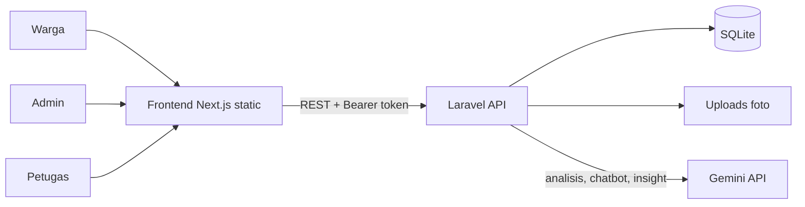

# KawalWarga — Integration PRD (Penyatuan Frontend + Backend)

> Dokumen ke-3 dari 3 PRD. Dipakai **setelah** Frontend (sampai Step 10) dan Backend (minimal B0–B6 + B10) selesai di perangkat masing-masing.
> Dibaca bersama `API-Contract.md` (v1.1), `Frontend-PRD.md`, `Backend-PRD.md`, dan `Integration-Prompt.md`.
> **Dokumen ini menggantikan** Step 11–12 di `Frontend-Prompt.md` dan Step 12 di `Backend-Prompt.md`. Jangan mengerjakan step itu di repo terpisah.
> Deadline lomba: **15 November 2026**.

---

## 1. Tujuan

1. Menyatukan dua repo (frontend dan backend) menjadi **satu repo GitHub (monorepo)** dengan riwayat commit kedua pengembang tetap utuh.
2. Menyambungkan frontend ke API asli, menemukan dan memperbaiki semua ketidakcocokan terhadap `API-Contract.md`.
3. Menguji alur penuh secara end-to-end (warga, admin, petugas, AI).
4. Deploy ke hosting (cPanel Anymhost) dan menyiapkan penyerahan lomba (README, demo, cadangan).

---

## 2. Syarat Masuk (Gate)

Penyatuan **baru dimulai** kalau semua ini terpenuhi. Kalau belum, selesaikan dulu di repo masing-masing.

| # | Syarat | Pemeriksa |
|---|---|---|
| G1 | Frontend selesai sampai **Step 10** (build static sukses, semua halaman jalan dengan mock) | Dandy |
| G2 | Backend selesai minimal **B0–B6 + B10** (alur penuh + data demo). B7–B9 (AI) boleh belum | Ilyasa |
| G3 | `docs/API-Contract.md` identik di kedua repo (nomor versi dan isi sama). Cek: `sha256sum docs/API-Contract.md` hasilnya sama | berdua |
| G4 | Tes dini deploy backend (B0b) sudah dilakukan dan hasilnya diketahui (health OK, koneksi ke Gemini OK atau gagal-dan-sudah-ada-rencana) | Ilyasa |
| G5 | Semua perubahan sudah di-push di kedua repo (tidak ada pekerjaan tertinggal di laptop) | berdua |
| G6 | Satu perangkat disiapkan untuk penyatuan dengan: Git, **PHP 8.2+**, **Composer**, **Node.js LTS** + npm, dan editor (VS Code/Cursor/Claude Code) | yang memegang perangkat |

Rencana waktu: gate dicek **12 November** (maksimal pagi 13 November).

---

## 3. Struktur Monorepo

```
kawalwarga/
├─ backend/                 # isi repo backend (Laravel)
├─ frontend/                # isi repo frontend (Next.js)
├─ docs/
│  ├─ API-Contract.md       # SATU salinan, sumber kebenaran
│  ├─ Frontend-PRD.md  Backend-PRD.md  Integration-PRD.md
│  ├─ Design.md   design/   # screenshot Figma
│  ├─ DEPLOY.md             # panduan deploy gabungan
│  ├─ INTEGRATION-REPORT.md # hasil audit kontrak (dibuat di I3)
│  ├─ E2E-CHECKLIST.md      # checklist uji (dibuat di I4)
│  ├─ DEMO-SCRIPT.md        # skrip demo (dibuat di I7)
│  └─ api-smoke-test.http
├─ scripts/
│  ├─ contract-check.mjs    # cek otomatis respons vs kontrak
│  └─ build-frontend-prod.sh
├─ .gitignore
└─ README.md                # README utama (arsitektur, fitur, cara jalan, screenshot)
```

Aturan:
- Hanya **satu** `API-Contract.md` (di `docs/`). Salinan di `backend/docs/` dan `frontend/docs/` dihapus (pindahkan dengan `git mv`).
- Dandy hanya mengubah `frontend/`, Ilyasa hanya mengubah `backend/`. `docs/` dan `scripts/` dikoordinasikan (beri tahu satu sama lain sebelum mengubah).
- Rahasia tidak boleh masuk repo: `backend/.env`, `backend/database/database.sqlite`, `frontend/.env.local`, `backend/public/uploads/*` (kecuali `.gitkeep` dan `.htaccess`), folder `frontend/out/`, `node_modules/`, `vendor/`.

---

## 4. Strategi Penyatuan Git

Tujuan: riwayat commit kedua repo **tetap ada** (penting untuk dokumentasi GitHub lomba).

### 4.1 Cara utama: `git subtree add`

```bash
# 1. Buat repo kosong di GitHub (misal: kawalwarga), lalu:
git clone <URL_REPO_BARU> kawalwarga && cd kawalwarga
git commit --allow-empty -m "chore: init monorepo"

# 2. Tarik kedua repo ke subfolder, riwayat commit ikut (tanpa --squash)
git subtree add --prefix=backend  <URL_REPO_BACKEND>  main
git subtree add --prefix=frontend <URL_REPO_FRONTEND> main
git push origin main
```

(Kalau branch default repo lama bernama `master`, ganti `main` dengan `master`.)

### 4.2 Cadangan jika `git subtree` tidak tersedia

```bash
git remote add fe <URL_REPO_FRONTEND> && git fetch fe
git merge -s ours --no-commit --allow-unrelated-histories fe/main
git read-tree --prefix=frontend/ -u fe/main
git commit -m "chore: merge frontend repo into monorepo"
# ulangi untuk backend dengan prefix backend/
```

### 4.3 Setelah penyatuan

- Repo lama **dibekukan**: tidak ada push baru. Tambahkan catatan di README repo lama ("Dipindahkan ke <URL monorepo>") dan boleh di-*archive*.
- Dandy dan Ilyasa sama-sama **clone monorepo** dan lanjut dari situ di perangkat masing-masing.
- Sebelum push: `git pull --rebase origin main`. Commit kecil, push sering. Konflik hampir tidak terjadi selama masing-masing hanya menyentuh foldernya.
- Beri tag: `v0.1.0-merged` setelah penyatuan, `v1.0.0` pada versi final.

---

## 5. Menjalankan Lokal (Satu Perangkat)

| Layanan | Perintah | URL |
|---|---|---|
| Backend | `cd backend && composer install && cp .env.example .env && php artisan key:generate && php artisan migrate:fresh --seed && php artisan serve` | `http://localhost:8000` |
| Frontend | `cd frontend && npm install && npm run dev` | `http://localhost:3000` |

Konfigurasi lokal yang harus cocok:

| File | Isi |
|---|---|
| `backend/.env` | `APP_URL=http://localhost:8000`, `FRONTEND_URL=http://localhost:3000`, `DB_DATABASE` (path absolut ke `database/database.sqlite`), `GEMINI_API_KEY`, `GEMINI_MODEL` |
| `frontend/.env.local` | `NEXT_PUBLIC_API_URL=http://localhost:8000/api/v1`, `NEXT_PUBLIC_USE_MOCK=false` |

Opsional: skrip root untuk menjalankan keduanya sekaligus (misalnya `package.json` di root dengan `concurrently`, atau dua terminal). Tidak wajib.

---

## 6. Audit Kontrak (Contract Audit)

Prinsip: **`API-Contract.md` adalah sumber kebenaran.** Ketidakcocokan tidak boleh diperbaiki diam-diam.

### 6.1 Langkah

1. Jalankan `scripts/contract-check.mjs` terhadap backend lokal (data demo). Skrip login sebagai admin dan petugas, memanggil semua endpoint P1, dan memeriksa: field wajib ada, tipe benar, nilai enum valid, format ID tiket `ADU-nnn`, format waktu `+07:00`, kode HTTP yang diharapkan (401/403/404/409/422).
2. Bandingkan hasilnya dengan tipe di `frontend/src/lib/types.ts` (nama field, nullable, enum).
3. Catat semua temuan di `docs/INTEGRATION-REPORT.md` dengan format tabel:

| # | Endpoint | Temuan | Penyebab | Keputusan (ubah backend / ubah frontend / ubah kontrak) | Status |
|---|---|---|---|---|---|

4. Keputusan **ubah kontrak** hanya boleh disepakati berdua. Naikkan versi (`1.1` → `1.2`), tambah baris Changelog, lalu sesuaikan kedua sisi dalam satu commit yang jelas (`docs:` + perbaikan).

### 6.2 Titik Rawan Ketidakcocokan (cek khusus)

| Area | Yang dicek |
|---|---|
| Enum | `jalan_rusak/sampah/lampu_mati`, `rendah/sedang/tinggi/darurat`, 5 status; tidak ada sisa nilai lama (`kritis`, `lainnya`) |
| ID tiket | backend tanpa `#`, frontend menambahkan `#` hanya untuk tampilan; input dengan `#` dinormalisasi |
| Foto | field `photo` (satu file), bukan `photos[]`; ukuran terkompres < 5 MB |
| Waktu | frontend menampilkan zona Jakarta dari ISO `+07:00` dengan benar |
| Nullable | `category` null saat `menunggu_verifikasi`; `latest_update`, `rejection`, `completion` null; `reporter.phone` null |
| Paginasi | `meta.current_page/last_page/per_page/total` terbaca benar di tabel riwayat dan antrean petugas |
| Error 422 | `errors` per field tampil di form frontend |
| URL | tidak ada garis miring di akhir URL API (`/reports`, bukan `/reports/`) |

---

## 7. Skenario Uji End-to-End

Dilakukan manual di browser (desktop **dan** HP asli), pertama di lokal, lalu ulang di production. Hasil dicentang di `docs/E2E-CHECKLIST.md`.

| ID | Skenario | Langkah ringkas | Hasil yang diharapkan |
|---|---|---|---|
| S1 | Warga kirim laporan | Isi deskripsi, ambil foto dari kamera HP, geser pin / pakai lokasi saya, kirim | Redirect ke halaman terkirim dengan ID `#ADU-xxx`; foto terkompres terunggah; muncul di antrean verifikasi admin |
| S2 | Warga lacak | Buka `/lacak?id=ADU-xxx`, coba juga input dengan `#` dan huruf kecil | Status "Menunggu Verifikasi"; timeline benar; tidak ada data pelapor |
| S3 | Admin setujui | Login admin, buka antrean verifikasi, cek rekomendasi AI (judul, kategori, urgensi, ringkasan, peringatan duplikat), ubah urgensi, setujui dengan catatan | Status jadi Menunggu Penanganan; muncul di antrean petugas dengan catatan admin |
| S4 | Admin tolak | Tolak laporan lain dengan alasan | Warga melihat halaman "Laporan tidak dapat diteruskan" + alasan, nama admin, waktu |
| S5 | Petugas tangani | Login petugas, ambil laporan, (opsional) kirim progres, selesaikan dengan 1 foto + catatan | Status Diproses lalu Selesai; di halaman lacak warga tampil Sebelum/Sesudah + catatan petugas |
| S6 | Dashboard | Buka dashboard admin | Angka kartu sesuai data, peta menampilkan pin berwarna dengan popup, tren kategori, ringkasan AI (atau fallback) |
| S7 | Chatbot | "Cek laporan saya #ADU-xxx", "Cara melapor", kirim nomor WA untuk "Lupa ID tiket" | Balasan sesuai data, kartu tiket bisa diklik ke halaman lacak |
| S8 | Otorisasi | Petugas membuka `/admin`, admin membuka `/petugas`, token dihapus/kedaluwarsa lalu buka halaman terproteksi | Redirect sesuai role; 401 mengembalikan ke `/masuk` |
| S9 | Ketahanan | Matikan backend lalu buka halaman; set `GEMINI_API_KEY` kosong lalu kirim laporan dan buka dashboard dan chatbot | Halaman menampilkan error + "Coba Lagi" (bukan blank); laporan tetap masuk dengan `ai_status failed`; dashboard memakai ringkasan fallback; chatbot membalas pesan fallback |
| S10 | Balapan | Dua petugas menekan "Ambil" untuk laporan yang sama hampir bersamaan | Satu berhasil, satu mendapat pesan "sudah diambil petugas lain" |
| S11 | Validasi | Kirim laporan tanpa foto, deskripsi pendek, nomor WA salah | Pesan error per field; tidak ada request tidak perlu |
| S12 | Upload besar | Foto 8 MB+ dari kamera HP | Terkompres otomatis dan berhasil terunggah |
| S13 | Responsif | Buka semua halaman di lebar 360 px | Tidak ada elemen terpotong; menu admin/petugas jadi drawer; tabel riwayat jadi kartu |
| S14 | Reset demo | `php artisan migrate:fresh --seed` | Data demo kembali bersih; akun demo bisa login |

---

## 8. Risiko Integrasi di cPanel dan Cara Menghindarinya

| Risiko | Gejala | Pencegahan / Solusi |
|---|---|---|
| Header `Authorization` tidak sampai ke PHP | Semua endpoint login-only dibalas 401 padahal token benar | Pastikan `backend/public/.htaccess` memuat aturan Laravel bawaan yang meneruskan header `Authorization` (`RewriteRule .* - [E=HTTP_AUTHORIZATION:%{HTTP:Authorization}]`) |
| CORS preflight gagal | Console browser: "blocked by CORS policy" | `FRONTEND_URL` di `.env` server harus **persis** sama dengan origin frontend (skema + domain, tanpa garis miring akhir); `allowed_headers` berisi `Authorization`; jalankan `php artisan config:clear` bila memakai cache |
| Mixed content | Request ke API diblokir | API dan frontend keduanya HTTPS; `NEXT_PUBLIC_API_URL` memakai `https://` |
| Foto tidak tampil | Gambar rusak | `APP_URL` production benar (`https://api...`); folder `public/uploads` bisa dibaca; `.htaccess` upload tidak memblokir gambar |
| Upload ditolak | 413 / 422 / request gagal | `upload_max_filesize` ≥ 8M dan `post_max_size` ≥ 10M; frontend sudah kompres |
| Request AI timeout | Laporan lambat dikirim | `max_execution_time` ≥ 30 dtk; timeout AI 12 dtk; fallback aktif |
| Koneksi keluar ke Gemini diblokir | `health/ai` gagal | Fitur AI memakai fallback; minta bantuan support hosting; demo tetap berjalan |
| Cache lama setelah re-deploy frontend | Halaman tampil versi lama | Hard refresh; file aset Next sudah ber-hash; HTML mungkin tercache → bersihkan cache browser saat uji |
| Rute statis 404 | Buka `/admin/riwayat/` langsung error | Pastikan upload **isi** folder `out/` (bukan folder `out` itu sendiri), `trailingSlash: true`, `404.html` ada |
| Zona waktu salah | Jam tampil beda 7 jam | `APP_TIMEZONE=Asia/Jakarta`; frontend memformat dengan zona Asia/Jakarta |
| SQLite tidak bisa ditulis | 500 saat membuat data | Izin tulis 775 untuk folder `database/` **dan** file `.sqlite` |

---

## 9. Deploy Production

Detail langkah backend ada di `Backend-PRD.md` bab 14 dan frontend di `Frontend-PRD.md` bab 9. Ringkasan urutan deploy gabungan:

1. **Backend dulu**: upload kode ke folder di luar `public_html`, subdomain `api` dengan document root `.../backend/public`, `.env` production, `composer install --no-dev` (atau upload `vendor/`), database (migrate + seed, atau upload sqlite hasil seed lokal + `public/uploads/`), izin tulis, `config:cache`/`route:cache`, HTTPS.
2. Tes `GET https://api.DOMAINKITA.com/api/v1/health` lalu `health/ai`.
3. **Frontend**: set `frontend/.env.production` (`NEXT_PUBLIC_API_URL=https://api.DOMAINKITA.com/api/v1`, `NEXT_PUBLIC_USE_MOCK=false`), `npm run build`, zip isi `out/`, upload dan extract ke `public_html`, tambahkan `.htaccess`.
4. Ulangi skenario S1–S14 di production (minimal S1–S8, S12, S13).
5. **Cadangan**: unduh zip `public_html` dan `database.sqlite` + `uploads/` yang sudah berisi data demo bersih, simpan di Google Drive/penyimpanan lain sebelum hari penyerahan.
6. Ganti password akun demo kalau URL akan dibagikan luas (atau cantumkan akun demo di README hanya jika memang diperlukan juri).

Paket rilis `scripts/build-frontend-prod.sh` membuat `dist/frontend-prod.zip` dari `frontend/out/` agar langkah 3 tinggal upload.

---

## 10. Penyerahan Akhir

### 10.1 README Utama (di root)

Wajib memuat: nama + tagline, masalah yang diselesaikan, daftar fitur per peran, **diagram arsitektur** (Mermaid, contoh di bawah), tech stack, peran AI, cara menjalankan lokal, akun demo, tautan demo (production), struktur repo, screenshot (desktop dan mobile), tim, dan link ke `docs/`.



### 10.2 Skrip Demo (5–7 menit, `docs/DEMO-SCRIPT.md`)

1. Masalah singkat (30 dtk): pengaduan publik tidak terstruktur dan tidak transparan.
2. **Warga** kirim laporan dari HP (foto + lokasi), dapat ID tiket.
3. **Admin** melihat rekomendasi AI (kategori, urgensi, ringkasan, peringatan duplikat), lalu menyetujui.
4. **Petugas** mengambil laporan, menyelesaikan dengan foto bukti + catatan.
5. **Warga** melacak: Sebelum/Sesudah + riwayat. Tunjukkan satu laporan **ditolak** dengan alasan.
6. **Dashboard** admin: statistik, peta persebaran, ringkasan eksekutif AI.
7. **Chatbot** cek status tiket.
8. Penutup (30 dtk): dampak (transparan, terstruktur, terbantu AI) dan batasan (AI hanya rekomendasi, keputusan di admin).

Siapkan: akun demo dan tiket contoh yang sudah dicatat, **rekaman video demo** sebagai cadangan kalau internet bermasalah, dan versi lokal yang siap jalan.

### 10.3 GitHub

- Riwayat commit bertahap dan rapi (jangan di-squash), dua kontributor terlihat.
- Tag `v1.0.0` pada versi final, deskripsi repo dan topik terisi, `LICENSE` bila diperlukan.
- Pastikan repo tidak berisi secret (cek `git log -p` sekilas untuk `.env`, API key, password).
- Kalau repo lomba harus publik/privat atau butuh akses juri, atur sebelum 15 November (cek ketentuan resmi lomba).

---

## 11. Rencana Kerja dan Checkpoint GitHub

Aturan sama: **tiap step selesai wajib commit dan push**, tidak menumpuk.

| Step | Isi | Target | Commit (contoh) |
|---|---|---|---|
| I0 | Cek gate G1–G6, buat monorepo (subtree), push | 12–13 Nov | `chore: init monorepo with frontend and backend` |
| I1 | Rapikan struktur: satu `docs/`, `.gitignore` root, README awal, tag `v0.1.0-merged` | 13 Nov | `chore: consolidate docs and gitignore` |
| I2 | Jalankan lokal berdampingan, env cocok, health + CORS OK | 13 Nov | `chore: local dev setup and env docs` |
| I3 | `contract-check.mjs` + `INTEGRATION-REPORT.md` + perbaiki ketidakcocokan | 13 Nov | `test: add contract check script` lalu `fix: align frontend and backend with contract` |
| I4 | Uji E2E S1–S14 (lokal) + perbaiki bug (beberapa commit kecil) | 13 Nov | `fix: ...` per bug, `docs: add e2e checklist` |
| I5 | Ketahanan: backend mati, AI gagal, token kedaluwarsa, upload besar | 13 Nov | `fix: harden error handling` |
| **Feature freeze** | Tidak ada fitur baru setelah malam 13 Nov | | |
| I6 | Build produksi, skrip paket rilis, `DEPLOY.md` gabungan | 14 Nov | `chore: production build and deploy scripts` |
| I7 | **Deploy production** + ulangi E2E | 14 Nov | `docs: record production deployment` |
| I8 | README akhir, screenshot, `DEMO-SCRIPT.md`, tag `v1.0.0`, cadangan | 14–15 Nov | `docs: final readme and demo script` |
| Buffer | 15 Nov: hanya perbaikan darurat dan pengiriman | 15 Nov | `fix: ...` |

---

## 12. Definition of Done

- [ ] Satu repo monorepo di GitHub dengan riwayat commit kedua pengembang utuh
- [ ] Hanya satu `API-Contract.md`; `INTEGRATION-REPORT.md` menunjukkan semua temuan **selesai**
- [ ] `scripts/contract-check.mjs` lulus tanpa temuan
- [ ] Skenario S1–S14 tercentang di lokal; S1–S8, S12, S13 tercentang di production
- [ ] Frontend dan backend berjalan di domain sendiri dengan HTTPS, CORS benar, upload foto dari HP berhasil
- [ ] AI berfungsi **dan** fallback terbukti berjalan saat AI dimatikan
- [ ] Data demo bersih dan akun demo berfungsi
- [ ] README utama, `DEPLOY.md`, `DEMO-SCRIPT.md`, screenshot tersedia
- [ ] Cadangan (zip frontend, sqlite + uploads, video demo) tersimpan di luar server
- [ ] Tag `v1.0.0`, tidak ada secret di repo

---

## 13. Di Luar Lingkup

Fitur baru setelah feature freeze, CI/CD otomatis, domain khusus per layanan, monitoring/analytics, uji otomatis end-to-end penuh (cukup manual + skrip `contract-check`).

---

## 14. Pembagian Peran Saat Penyatuan

| Peran | Tanggung jawab |
|---|---|
| Ilyasa | pemimpin penyatuan dan deploy: monorepo, audit kontrak sisi backend, server production, cadangan |
| Dandy | perbaikan sisi frontend dari temuan audit dan E2E, build produksi, responsif dan polish |
| Berdua | keputusan perubahan kontrak, uji E2E (bagi dua: sisi warga/petugas vs admin), demo |

Aturan komunikasi: temuan bug ditulis di `INTEGRATION-REPORT.md` (satu sumber), bukan hanya di chat, supaya tidak ada yang terlewat.
